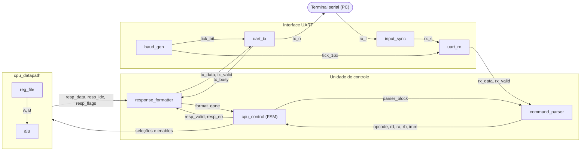

<div align="center">

# CPU de 8 Bits descrita em VHDL

</div>

#### Autores:
- Daniel Birenbaum
- Luan Machado
- Lucas Elbert
#### Professor e Orientador:
- Prof. Fernando Dias

## Sumário
[Visão geral](#visão-geral) \
[Instruções](#instruções) \
[Arquitetura](#arquitetura) \
[Hierarquia do projeto](#hierarquia-do-projeto) \
[Documentação](#documentação) 

## Visão geral

O projeto é um processador simples de **8 bits** com oito registradores (**R0 a R7**) que executa
comandos recebidos por um terminal serial. O computador envia uma linha de texto; a FPGA a
interpreta, opera sobre os registradores e responde com o resultado em caracteres **ASCII**.

| | |
|---|---|
| **Dados** | 8 bits, oito registradores R0–R7 |
| **Comunicação** | UART 115200 bit/s, 8N1 (clock padrão de 50 MHz, parametrizável) |
| **Controle** | Máquina de estados; um comando por vez, sem pipeline |
| **Memória** | Não há memória de programa nem de dados externa |
| **Barramentos** | Fontes selecionadas por multiplexadores; sem buffers *three-state* |
| **Banco de registradores** | 2 portas de leitura e 1 de escrita |
| **Flags** | `Z` zero, `C` carry, `N` negativo, `V` overflow |

## Instruções

| Comando | Operação | Flags | Resposta |
|---|---|---|---|
| `LDI Rd,HH` | `Rd ← HH` | preserva | `Rd = HH` |
| `MOV Rd,Ra` | `Rd ← Ra` | preserva | `Rd = HH` |
| `ADD Rd,Ra,Rb` | `Rd ← Ra + Rb` | atualiza | `Rd = HH Z=z C=c N=n V=v` |
| `SUB Rd,Ra,Rb` | `Rd ← Ra − Rb` | atualiza | idem |
| `AND Rd,Ra,Rb` | `Rd ← Ra and Rb` | atualiza | idem |
| `OR Rd,Ra,Rb` | `Rd ← Ra or Rb` | atualiza | idem |
| `XOR Rd,Ra,Rb` | `Rd ← Ra xor Rb` | atualiza | idem |
| `NOT Rd,Ra` | `Rd ← not Ra` | atualiza | idem |
| `ADDI Rd,Ra,HH` | `Rd ← Ra + HH` | atualiza | idem |

**Regras de sintaxe**

- Mnemônico em **maiúsculas** (até 4 letras), seguido de espaço.
- Operandos separados por vírgula e/ou espaços.
- Registradores de `R0` a `R7`; imediatos com **2 dígitos hexadecimais maiúsculos** (`00`–`FF`), sem prefixo.
- Linhas de até **32 caracteres**; linha vazia é ignorada.
- Qualquer outra coisa (operação desconhecida, operando inválido, falta ou excesso de operandos, erro de quadro na UART) devolve `ERR`.

## Arquitetura

A arquitetura se divide em **interface UART**, **unidade de controle** e **caminho de dados**.
O [`cpu_top`](src/cpu_top.vhd) liga todos os módulos e expõe apenas `clk`, `rst_i`, `rx_i` e `tx_o`.



**Fluxo de um comando**

1. O terminal envia uma linha ASCII terminada em `CR`, `LF` ou `CR+LF`.
2. `uart_rx` entrega `rx_data` com um pulso `rx_valid` de 1 ciclo.
3. `command_parser` guarda a linha, decodifica e valida; emite `cmd_valid` ou `cmd_error`.
4. `cpu_control` executa: escreve o resultado no banco e captura a resposta na mesma borda.
5. `response_formatter` monta `Rn = HH …` (ou `ERR`) e envia byte a byte pela `uart_tx`.
6. Após o último *stop bit*, `format_done` libera o parser para o próximo comando.


## Hierarquia do projeto
```
cpu8vhdl-main/
├── docs/                   # Documentação e diagramas da arquitetura
│   ├── implemented/        # Esquemáticos e documentos gerados do RTL
│   │   ├── cpu/
│   │   └── uart/
│   └── theoretical/        # Diagramas teóricos iniciais
├── sim/                    # Testbenches e formas de onda de simulação
│   ├── cpu/
│   └── uart/
└── src/                    # Código-fonte RTL em VHDL
├── cpu/
│   ├── alu.vhd
│   ├── command_parser.vhd
│   ├── cpu_control.vhd
│   ├── cpu_datapath.vhd
│   ├── reg_file.vhd
│   └── response_formatter.vhd
├── uart/
│   ├── baud_gen.vhd
│   ├── input_sync.vhd
│   ├── uart_rx.vhd
│   └── uart_tx.vhd
├── cpu_pkg.vhd
└── cpu_top.vhd
```


## Documentação

| Onde | O que encontrar |
|---|---|
| [`docs/readme.md`](docs/readme.md) | Tabela de todos os arquivos, ISA, formato das respostas, genéricos do topo |
| [`docs/implemented/uart/`](docs/implemented/uart/README.md) | Interface UART: sincronização, geração de baud rate, RX e TX |
| [`docs/implemented/cpu/`](docs/readme.md#documentação-por-módulo) | Parser, controle, caminho de dados, banco de registradores, ULA e formatador |
| [`docs/theoretical/`](docs/theoretical/) | Diagramas de pré-projeto, com as especificações iniciais |
| [`sim/README.md`](sim/README.md) | Testbenches, cobertura e como simular |

## Divisão de responsabilidade
| Integrante | Módulos |
|---|---|
| **Daniel Birenbaum** | Interface UART — [`input_sync`](src/uart/input_sync.vhd), [`baud_gen`](src/uart/baud_gen.vhd), [`uart_rx`](src/uart/uart_rx.vhd), [`uart_tx`](src/uart/uart_tx.vhd) — e integração em [`cpu_top`](src/cpu_top.vhd) |
| **Lucas Elbert** | Controle — [`command_parser`](src/cpu/command_parser.vhd), [`cpu_control`](src/cpu/cpu_control.vhd), [`response_formatter`](src/cpu/response_formatter.vhd) |
| **Luan Machado** | Caminho de dados — [`cpu_datapath`](src/cpu/cpu_datapath.vhd), [`reg_file`](src/cpu/reg_file.vhd), [`alu`](src/cpu/alu.vhd) |

O pacote [`cpu_pkg`](src/cpu_pkg.vhd) foi desenvolvido em conjunto.