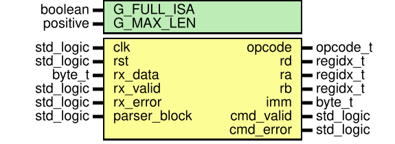

# Entity: command_parser 
- **File**: command_parser.vhd

## Diagram

## Generics

| Generic name | Type     | Value | Description |
| ------------ | -------- | ----- | ----------- |
| G_FULL_ISA   | boolean  | true  |             |
| G_MAX_LEN    | positive | 32    |             |

## Ports

| Port name    | Direction | Type      | Description |
| ------------ | --------- | --------- | ----------- |
| clk          | in        | std_logic |             |
| rst          | in        | std_logic |             |
| rx_data      | in        | byte_t    |             |
| rx_valid     | in        | std_logic |             |
| rx_error     | in        | std_logic |             |
| parser_block | in        | std_logic |             |
| opcode       | out       | opcode_t  |             |
| rd           | out       | regidx_t  |             |
| ra           | out       | regidx_t  |             |
| rb           | out       | regidx_t  |             |
| imm          | out       | byte_t    |             |
| cmd_valid    | out       | std_logic |             |
| cmd_error    | out       | std_logic |             |

## Signals

| Name        | Type                          | Description |
| ----------- | ----------------------------- | ----------- |
| buf         | buf_t                         |             |
| len         | integer range 0 to G_MAX_LEN  |             |
| line_bad    | std_logic                     |             |
| state       | state_t                       |             |
| phase       | phase_t                       |             |
| ptr         | integer range 0 to G_MAX_LEN  |             |
| mnem        | std_logic_vector(31 downto 0) |             |
| mlen        | integer range 0 to 4          |             |
| op_val      | opval_t                       |             |
| op_imm      | std_logic_vector(0 to 2)      |             |
| nops        | integer range 0 to 3          |             |
| opcode_r    | opcode_t                      |             |
| rd_r        | regidx_t                      |             |
| ra_r        | regidx_t                      |             |
| rb_r        | regidx_t                      |             |
| imm_r       | byte_t                        |             |
| cmd_valid_r | std_logic                     |             |
| cmd_error_r | std_logic                     |             |

## Types

| Name    | Type | Description |
| ------- | ---- | ----------- |
| buf_t   |      |             |
| opval_t |      |             |

## Enums

### *state_t*
| Name        | Description                               |
| ----------- | ----------------------------------------- |
| ST_RX       | recebendo caracteres                      |
| ST_DECODE   | varrendo o buffer (1 caractere por ciclo) |
| ST_VALIDATE | conferindo operacao x operandos           |
| ST_WAIT_ACK | comando entregue: espera parser_block = 1 |
| ST_WAIT_REL |                                           |

### *phase_t*
| Name     | Description                          |
| -------- | ------------------------------------ |
| PH_MNEM  | lendo as letras da operacao          |
| PH_SKIP  | pulando espacos antes de um operando |
| PH_TOKEN | lendo Rn ou HH                       |
| PH_AFTER |                                      |

## Processes
- unnamed: ( clk )
