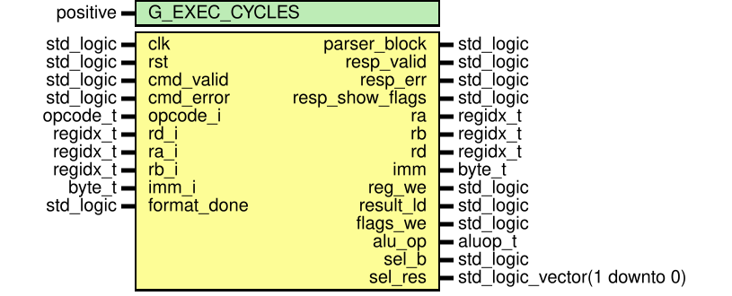
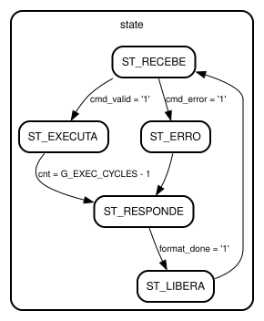

# Entity: cpu_control 
- **File**: cpu_control.vhd

## Diagram

## Generics

| Generic name  | Type     | Value | Description |
| ------------- | -------- | ----- | ----------- |
| G_EXEC_CYCLES | positive | 2     |             |

## Ports

| Port name       | Direction | Type                         | Description |
| --------------- | --------- | ---------------------------- | ----------- |
| clk             | in        | std_logic                    |             |
| rst             | in        | std_logic                    |             |
| cmd_valid       | in        | std_logic                    |             |
| cmd_error       | in        | std_logic                    |             |
| opcode_i        | in        | opcode_t                     |             |
| rd_i            | in        | regidx_t                     |             |
| ra_i            | in        | regidx_t                     |             |
| rb_i            | in        | regidx_t                     |             |
| imm_i           | in        | byte_t                       |             |
| format_done     | in        | std_logic                    |             |
| parser_block    | out       | std_logic                    |             |
| resp_valid      | out       | std_logic                    |             |
| resp_err        | out       | std_logic                    |             |
| resp_show_flags | out       | std_logic                    |             |
| ra              | out       | regidx_t                     |             |
| rb              | out       | regidx_t                     |             |
| rd              | out       | regidx_t                     |             |
| imm             | out       | byte_t                       |             |
| reg_we          | out       | std_logic                    |             |
| result_ld       | out       | std_logic                    |             |
| flags_we        | out       | std_logic                    |             |
| alu_op          | out       | aluop_t                      |             |
| sel_b           | out       | std_logic                    |             |
| sel_res         | out       | std_logic_vector(1 downto 0) |             |

## Signals

| Name        | Type                                 | Description |
| ----------- | ------------------------------------ | ----------- |
| state       | state_t                              |             |
| cnt         | integer range 0 to G_EXEC_CYCLES - 1 |             |
| opcode_r    | opcode_t                             |             |
| rd_r        | regidx_t                             |             |
| ra_r        | regidx_t                             |             |
| rb_r        | regidx_t                             |             |
| imm_r       | byte_t                               |             |
| err_r       | std_logic                            |             |
| dec_alu_op  | aluop_t                              |             |
| dec_sel_b   | std_logic                            |             |
| dec_sel_res | std_logic_vector(1 downto 0)         |             |
| dec_upd_flg | std_logic                            |             |
| last_exec   | std_logic                            |             |

## Enums

### *state_t*
| Name        | Description |
| ----------- | ----------- |
| ST_RECEBE   |             |
| ST_EXECUTA  |             |
| ST_ERRO     |             |
| ST_RESPONDE |             |
| ST_LIBERA   |             |

## Processes
- unnamed: ( clk )
- unnamed: ( opcode_r )

## State machines

