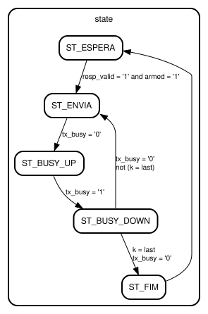

# Entity: response_formatter 
- **File**: response_formatter.vhd

## Diagram

## Generics

| Generic name | Type    | Value | Description |
| ------------ | ------- | ----- | ----------- |
| G_FLAGS_EN   | boolean | true  |             |

## Ports

| Port name       | Direction | Type                         | Description |
| --------------- | --------- | ---------------------------- | ----------- |
| clk             | in        | std_logic                    |             |
| rst             | in        | std_logic                    |             |
| resp_valid      | in        | std_logic                    |             |
| resp_err        | in        | std_logic                    |             |
| resp_show_flags | in        | std_logic                    |             |
| resp_idx        | in        | regidx_t                     |             |
| resp_data       | in        | byte_t                       |             |
| resp_flags      | in        | std_logic_vector(3 downto 0) |             |
| tx_busy         | in        | std_logic                    |             |
| tx_data         | out       | byte_t                       |             |
| tx_valid        | out       | std_logic                    |             |
| format_done     | out       | std_logic                    |             |

## Signals

| Name       | Type                          | Description |
| ---------- | ----------------------------- | ----------- |
| state      | state_t                       |             |
| k          | integer range 0 to LAST_FLAGS |             |
| last       | integer range 0 to LAST_FLAGS |             |
| armed      | std_logic                     |             |
| err_l      | std_logic                     |             |
| flags_l    | std_logic                     |             |
| idx_l      | regidx_t                      |             |
| data_l     | byte_t                        |             |
| flg_l      | std_logic_vector(3 downto 0)  |             |
| tx_valid_r | std_logic                     |             |
| char       | byte_t                        |             |

## Constants

| Name       | Type    | Value | Description |
| ---------- | ------- | ----- | ----------- |
| LAST_ERR   | integer | 4     |             |
| LAST_BASIC | integer | 8     |             |
| LAST_FLAGS | integer | 24    |             |

## Enums

### *state_t*
| Name         | Description |
| ------------ | ----------- |
| ST_ESPERA    |             |
| ST_ENVIA     |             |
| ST_BUSY_UP   |             |
| ST_BUSY_DOWN |             |
| ST_FIM       |             |

## Processes
- unnamed: ( clk )
- unnamed: ( k, err_l, flags_l, idx_l, data_l, flg_l )

## State machines

