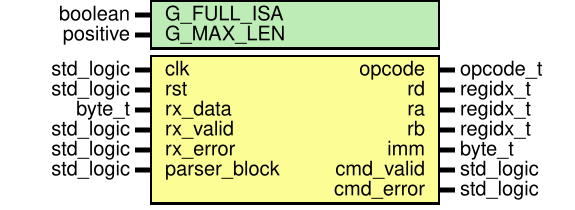
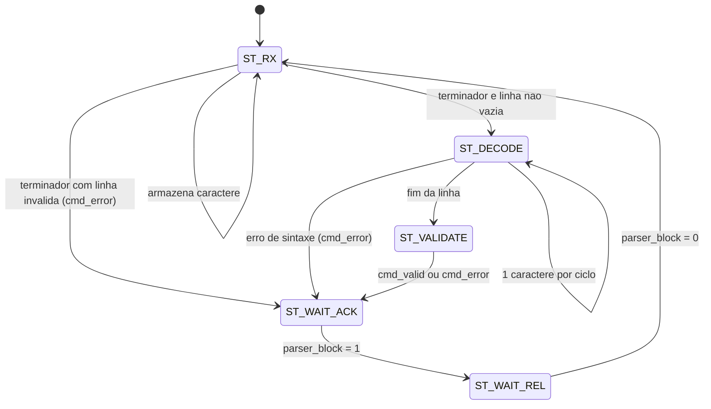

# `command_parser`

[← Índice da documentação](../../../readme.md) · **Autor:** Lucas Elbert

| | |
|---|---|
| **Fonte** | [`src/cpu/command_parser.vhd`](../../../../src/cpu/command_parser.vhd) |
| **Testbench** | [`sim/cpu/command_parser/tb_command_parser.vhd`](../../../../sim/cpu/command_parser/tb_command_parser.vhd) |
| **Teórico** | [`05_command_parser.png`](../../../theoretical/05_command_parser.png) |

## Diagrama

## Genéricos

| Genérico | Tipo | Padrão | Descrição |
|---|---|---|---|
| `G_FULL_ISA` | `boolean` | `true` | `true`: ISA completa; `false`: aceita só `LDI` e `ADD` (marco M1) |
| `G_MAX_LEN` | `positive` | `32` | Tamanho máximo da linha; o caractere seguinte invalida a linha |

## Portas

| Porta | Dir. | Tipo | Descrição |
|---|---|---|---|
| `clk` | in | `std_logic` | Clock principal |
| `rst` | in | `std_logic` | Reset síncrono (`rst_s`) |
| `rx_data` | in | `byte_t` | Byte vindo do [`uart_rx`](../../uart/uart_rx/readme.md) |
| `rx_valid` | in | `std_logic` | Pulso de 1 ciclo: `rx_data` válido |
| `rx_error` | in | `std_logic` | Erro de quadro: invalida a linha atual até o terminador |
| `parser_block` | in | `std_logic` | Vem do `cpu_control`: `1` = comando em andamento, parser não aceita novos caracteres |
| `opcode` | out | `opcode_t` | Operação decodificada (ver [`cpu_pkg`](../../cpu_pkg/readme.md)) |
| `rd` | out | `regidx_t` | Registrador de destino |
| `ra` | out | `regidx_t` | Primeiro registrador de origem |
| `rb` | out | `regidx_t` | Segundo registrador de origem |
| `imm` | out | `byte_t` | Imediato de 8 bits |
| `cmd_valid` | out | `std_logic` | Pulso de 1 ciclo: comando válido, campos prontos |
| `cmd_error` | out | `std_logic` | Pulso de 1 ciclo: comando inválido (vira `ERR`) |

## Máquina de estados

| Estado | O que faz |
|---|---|
| `ST_RX` | Só age com `parser_block = 0`. Guarda caracteres no buffer; `CR` ou `LF` fecha a linha. Linha vazia é ignorada; `rx_error` ou excesso de caracteres marca a linha como inválida |
| `ST_DECODE` | Varre o buffer, **1 caractere por ciclo**, pelas fases abaixo |
| `ST_VALIDATE` | Confere mnemônico × formato dos operandos e registra os campos |
| `ST_WAIT_ACK` | Comando entregue; espera `parser_block = 1` (o controle aceitou) |
| `ST_WAIT_REL` | Espera `parser_block = 0` (estado `LIBERA` do controle) e volta a `ST_RX` |

### Fases do decodificador

| Fase | O que lê |
|---|---|
| `PH_MNEM` | Letras maiúsculas do mnemônico (máx. 4); um espaço encerra |
| `PH_SKIP` | Pula espaços antes de um operando |
| `PH_TOKEN` | Lê um operando: `Rn` (`n` de 0 a 7) ou `HH` (2 dígitos hex maiúsculos); aceita no máximo 3 |
| `PH_AFTER` | Depois de um operando: espaço, vírgula ou fim da linha |

### Formatos aceitos

| Mnemônico | Operandos | Padrão |
|---|---|---|
| `LDI` | `Rd,HH` | registrador + imediato |
| `ADD` `SUB` `AND` `OR` `XOR` | `Rd,Ra,Rb` | 3 registradores |
| `NOT` `MOV` | `Rd,Ra` | 2 registradores |
| `ADDI` | `Rd,Ra,HH` | 2 registradores + imediato |

Com `G_FULL_ISA = false` só `LDI` e `ADD` são aceitos. Qualquer outro caso gera `cmd_error`: registrador fora de
`R0`–`R7`, operação desconhecida, imediato inválido, falta ou excesso de operandos, ou linha com `rx_error`.

Sinais internos

| Sinal | Tipo | Descrição |
|---|---|---|
| `buf` | `buf_t` (`G_MAX_LEN` × `byte_t`) | Buffer da linha |
| `len` | `integer range 0 to G_MAX_LEN` | Caracteres guardados |
| `line_bad` | `std_logic` | Linha invalidada por `rx_error` ou excesso de caracteres |
| `state` / `phase` | `state_t` / `phase_t` | Estado principal e fase do decodificador |
| `ptr` | `integer range 0 to G_MAX_LEN` | Posição atual na varredura |
| `mnem` / `mlen` | `std_logic_vector(31 downto 0)` / `integer` | Mnemônico empacotado (ver `pack4`) e seu tamanho |
| `op_val` | `opval_t` (3 × `byte_t`) | Valor de cada operando |
| `op_imm` | `std_logic_vector(0 to 2)` | `1` = operando é imediato, `0` = registrador |
| `nops` | `integer range 0 to 3` | Quantidade de operandos lidos |
| `opcode_r`, `rd_r`, `ra_r`, `rb_r`, `imm_r` | — | Campos registrados que alimentam as saídas |
| `cmd_valid_r` / `cmd_error_r` | `std_logic` | Pulsos de saída |

