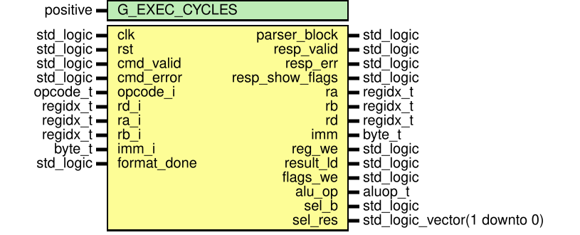
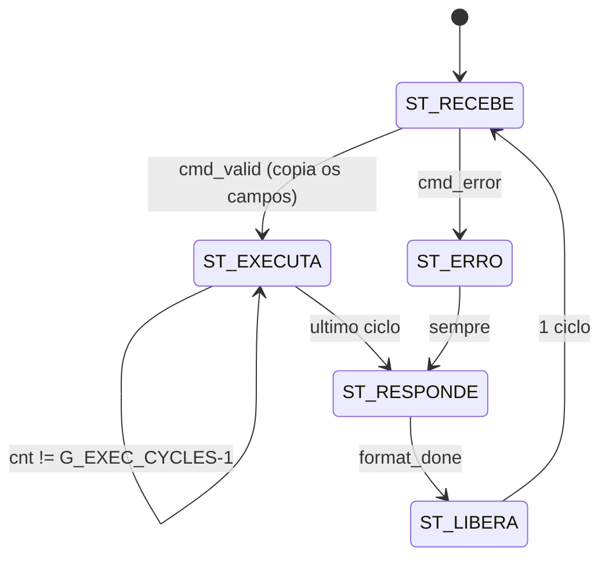

# `cpu_control`

[← Índice da documentação](../../../readme.md) · **Autor:** Lucas Elbert

| | |
|---|---|
| **Fonte** | [`src/cpu/cpu_control.vhd`](../../../../src/cpu/cpu_control.vhd) |
| **Testbench** | [`sim/cpu/cpu_control/tb_cpu_control.vhd`](../../../../sim/cpu/cpu_control/tb_cpu_control.vhd) |
| **Teórico** | [`06_cpu_control.png`](../../../theoretical/06_cpu_control.png) |

## Diagrama

## Genéricos

| Genérico | Tipo | Padrão | Descrição |
|---|---|---|---|
| `G_EXEC_CYCLES` | `positive` | `2` | Ciclos em `EXECUTA` (≥ 1); 2 dá folga ao caminho banco → ULA → MUX |

## Portas

| Porta | Dir. | Tipo | Descrição |
|---|---|---|---|
| `clk` | in | `std_logic` | Clock principal |
| `rst` | in | `std_logic` | Reset síncrono (`rst_s`) |
| `cmd_valid` | in | `std_logic` | Do parser: comando válido |
| `cmd_error` | in | `std_logic` | Do parser: comando inválido |
| `opcode_i` | in | `opcode_t` | Operação vinda do parser |
| `rd_i`, `ra_i`, `rb_i` | in | `regidx_t` | Registradores vindos do parser |
| `imm_i` | in | `byte_t` | Imediato vindo do parser |
| `format_done` | in | `std_logic` | Do formatador: resposta inteira enviada |
| `parser_block` | out | `std_logic` | Ao parser: `0` em `RECEBE` e `LIBERA`, `1` nos demais |
| `resp_valid` | out | `std_logic` | Ao formatador: `1` durante `RESPONDE` |
| `resp_err` | out | `std_logic` | Ao formatador: resposta é `ERR` |
| `resp_show_flags` | out | `std_logic` | Ao formatador: incluir `Z C N V` (operação atualiza flags e não houve erro) |
| `ra`, `rb`, `rd` | out | `regidx_t` | Ao datapath: endereços de leitura A/B e de escrita |
| `imm` | out | `byte_t` | Ao datapath: imediato |
| `reg_we` | out | `std_logic` | Habilita escrita no banco (só no último ciclo de `EXECUTA`) |
| `result_ld` | out | `std_logic` | Captura resultado e índice para a resposta (mesma borda de `reg_we`) |
| `flags_we` | out | `std_logic` | Atualiza as flags (último ciclo de `EXECUTA` e operação que atualiza flags) |
| `alu_op` | out | `aluop_t` | Operação da ULA |
| `sel_b` | out | `std_logic` | MUX B: `0` = `Rb`, `1` = imediato |
| `sel_res` | out | `std_logic_vector(1 downto 0)` | MUX Resultado: `00` ULA, `01` Ra, `10` Rb, `11` imediato |

## Máquina de estados

| Estado | `parser_block` | O que faz |
|---|---|---|
| `ST_RECEBE` | `0` | Parser livre. `cmd_valid` copia os campos e vai a `EXECUTA`; `cmd_error` vai a `ERRO` |
| `ST_EXECUTA` | `1` | Dura `G_EXEC_CYCLES` ciclos com seleções estáveis. No último, `reg_we` e `result_ld` (e `flags_we`, se a operação atualiza flags) ficam em `1`: escrita no banco e captura da resposta acontecem **na mesma borda** |
| `ST_ERRO` | `1` | Nenhuma escrita no banco; `resp_err = 1` |
| `ST_RESPONDE` | `1` | `resp_valid = 1` até `format_done` |
| `ST_LIBERA` | `0` | 1 ciclo liberando o parser; volta a `RECEBE` |

### Decodificação do opcode

| Opcode | `alu_op` | `sel_b` | `sel_res` | Atualiza flags |
|---|---|---|---|---|
| `LDI` | `ADD` (don't care) | `REG` | `IMM` | não |
| `ADD` / `SUB` / `AND` / `OR` / `XOR` / `NOT` | respectivo | `REG` | `ALU` | sim |
| `MOV` | `ADD` (don't care) | `REG` | `A` | não |
| `ADDI` | `ADD` | `IMM` | `ALU` | sim |

Sinais internos

| Sinal | Tipo | Descrição |
|---|---|---|
| `state` | `state_t` | Estado atual |
| `cnt` | `integer range 0 to G_EXEC_CYCLES - 1` | Ciclo dentro de `EXECUTA` |
| `opcode_r`, `rd_r`, `ra_r`, `rb_r`, `imm_r` | — | Cópia do comando em execução |
| `err_r` | `std_logic` | Comando atual é um erro |
| `dec_alu_op`, `dec_sel_b`, `dec_sel_res`, `dec_upd_flg` | — | Decodificação combinacional de `opcode_r` |
| `last_exec` | `std_logic` | `1` no último ciclo de `EXECUTA` |

