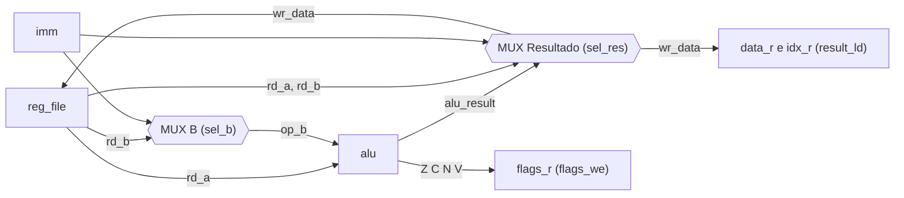

# `cpu_datapath`

[← Índice da documentação](../../../readme.md) · **Autor:** Luan Machado

| | |
|---|---|
| **Fonte** | [`src/cpu/cpu_datapath.vhd`](../../../../src/cpu/cpu_datapath.vhd) |
| **Testbench** | [`sim/cpu/cpu_datapath/tb_cpu_datapath_unit.vhd`](../../../../sim/cpu/cpu_datapath/tb_cpu_datapath_unit.vhd) |
| **Teórico** | [`09_cpu_datapath.png`](../../../theoretical/09_cpu_datapath.png) |
| **Instancia** | [`reg_file`](../reg_file/readme.md) (`u_regs`) · [`alu`](../alu/readme.md) (`u_alu`) |

## Diagrama

## Fluxo de dados

## Portas

| Porta | Dir. | Tipo | Descrição |
|---|---|---|---|
| `clk` | in | `std_logic` | Clock principal |
| `rst` | in | `std_logic` | Reset síncrono; zera banco, flags e captura |
| `ra` | in | `regidx_t` | Endereço do primeiro registrador lido |
| `rb` | in | `regidx_t` | Endereço do segundo registrador lido |
| `rd` | in | `regidx_t` | Endereço do registrador de destino |
| `imm` | in | `byte_t` | Imediato da instrução |
| `reg_we` | in | `std_logic` | Habilita escrita no banco |
| `result_ld` | in | `std_logic` | Habilita a captura de `wr_data` e `rd` para a resposta |
| `flags_we` | in | `std_logic` | Habilita a atualização do registrador de flags |
| `alu_op` | in | `aluop_t` | Operação da ULA |
| `sel_b` | in | `std_logic` | MUX B: `0` = segunda leitura (`Rb`), `1` = imediato |
| `sel_res` | in | `std_logic_vector(1 downto 0)` | MUX Resultado: `00` ULA, `01` Ra, `10` Rb, `11` imediato |
| `resp_data` | out | `byte_t` | Valor capturado, estável para o formatador |
| `resp_idx` | out | `regidx_t` | Índice do registrador de destino capturado |
| `resp_flags` | out | `std_logic_vector(3 downto 0)` | Flags `Z C N V` (bit 3 = `Z`, bit 0 = `V`) |

## Comportamento

- **MUX B:** `op_b = imm` quando `sel_b = SELB_IMM`, senão `rd_b`.
- **MUX Resultado:** `wr_data` vem da ULA, de `rd_a`, de `rd_b` ou do imediato, conforme `sel_res`. Esse mesmo valor vai ao banco e ao registrador de captura.
- **Flags:** `flags_r` só muda quando `flags_we = 1`; `LDI` e `MOV` as preservam.
- **Captura:** com `result_ld = 1`, grava `data_r ← wr_data` e `idx_r ← rd`, de modo que a resposta fica estável mesmo depois de o controle liberar os endereços.

Sinais internos

| Sinal | Tipo | Descrição |
|---|---|---|
| `rd_a`, `rd_b` | `byte_t` | Dados lidos do banco |
| `op_b` | `byte_t` | Entrada B da ULA (após o MUX B) |
| `alu_result` | `byte_t` | Resultado da ULA |
| `alu_z`, `alu_c`, `alu_n`, `alu_v` | `std_logic` | Flags da ULA |
| `wr_data` | `byte_t` | Dado escolhido pelo MUX Resultado |
| `flags_r` | `std_logic_vector(3 downto 0)` | Flags registradas |
| `data_r`, `idx_r` | `byte_t` / `regidx_t` | Resposta capturada |

