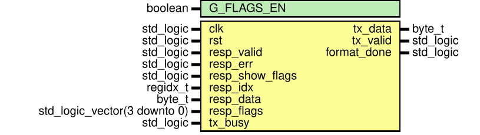
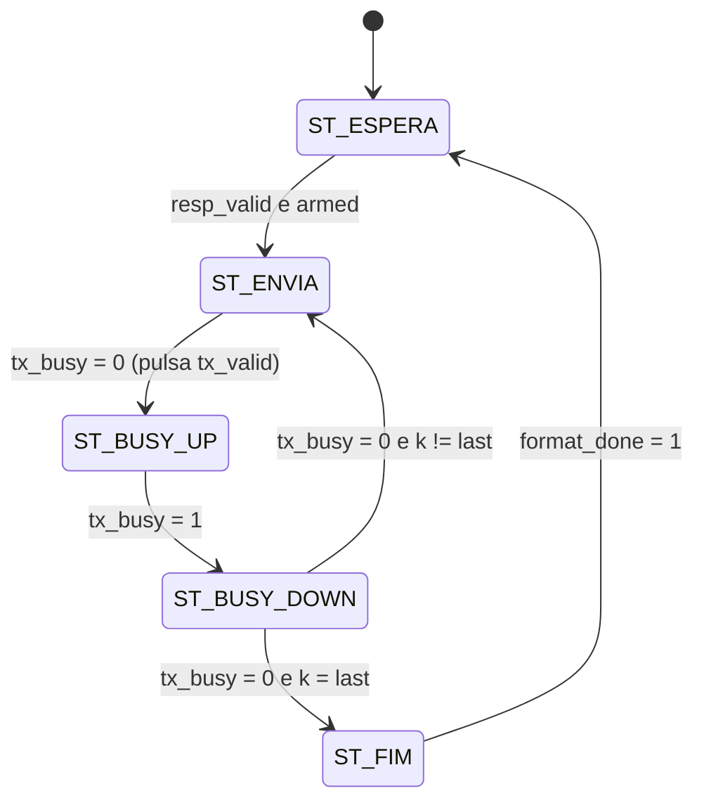

# `response_formatter`

[← Índice da documentação](../../../readme.md) · **Autor:** Lucas Elbert

| | |
|---|---|
| **Fonte** | [`src/cpu/response_formatter.vhd`](../../../../src/cpu/response_formatter.vhd) |
| **Testbench** | [`sim/cpu/response_formatter/tb_response_formatter.vhd`](../../../../sim/cpu/response_formatter/tb_response_formatter.vhd) |
| **Teórico** | [`10_response_formatter.png`](../../../theoretical/10_response_formatter.png) |

## Diagrama

## Genéricos

| Genérico | Tipo | Padrão | Descrição |
|---|---|---|---|
| `G_FLAGS_EN` | `boolean` | `true` | `false`: nunca envia flags (marco M1) |

## Portas

| Porta | Dir. | Tipo | Descrição |
|---|---|---|---|
| `clk` | in | `std_logic` | Clock principal |
| `rst` | in | `std_logic` | Reset síncrono (`rst_s`) |
| `resp_valid` | in | `std_logic` | Do controle: há resposta a enviar |
| `resp_err` | in | `std_logic` | Do controle: a resposta é `ERR` |
| `resp_show_flags` | in | `std_logic` | Do controle: incluir `Z C N V` |
| `resp_idx` | in | `regidx_t` | Índice do registrador de destino (capturado no datapath) |
| `resp_data` | in | `byte_t` | Valor escrito (capturado no datapath) |
| `resp_flags` | in | `std_logic_vector(3 downto 0)` | Flags `Z C N V` |
| `tx_busy` | in | `std_logic` | Da [`uart_tx`](../../uart/uart_tx/readme.md): transmissão em andamento |
| `tx_data` | out | `byte_t` | Byte a transmitir |
| `tx_valid` | out | `std_logic` | Pulso de 1 ciclo pedindo o envio de `tx_data` |
| `format_done` | out | `std_logic` | Pulso de 1 ciclo: último byte enviado |

## Formato das respostas

`CR = 0x0D`, `LF = 0x0A`.

| Caso | Texto | Bytes | `LAST_*` (índice do último byte) |
|---|---|---|---|
| `LDI` / `MOV` | `Rn = HH` CR LF | 9 | `LAST_BASIC = 8` |
| Com flags | `Rn = HH Z=z C=c N=n V=v` CR LF | 25 | `LAST_FLAGS = 24` |
| Erro | `ERR` CR LF | 5 | `LAST_ERR = 4` |

## Máquina de estados

| Estado | O que faz |
|---|---|
| `ST_ESPERA` | Com `resp_valid = 1` e `armed = 1`, copia a resposta (`err_l`, `idx_l`, `data_l`, `flg_l`), define `last` e zera `k` |
| `ST_ENVIA` | Só com `tx_busy = 0`: pulsa `tx_valid` por 1 ciclo com `tx_data` estável |
| `ST_BUSY_UP` | Espera `tx_busy` subir (a UART aceitou o byte) |
| `ST_BUSY_DOWN` | Espera `tx_busy` cair (fim do *stop bit*); avança `k` ou termina |
| `ST_FIM` | `format_done = 1` por 1 ciclo e volta a `ESPERA` |

> [!NOTE]
> `armed` só volta a `1` depois que `resp_valid` cair a `0`. Isso evita enviar a mesma resposta duas vezes.

Sinais internos

| Sinal | Tipo | Descrição |
|---|---|---|
| `state` | `state_t` | Estado atual |
| `k` | `integer range 0 to LAST_FLAGS` | Índice do byte em envio |
| `last` | `integer range 0 to LAST_FLAGS` | Índice do último byte desta resposta |
| `armed` | `std_logic` | `resp_valid` já voltou a `0` desde a última resposta |
| `err_l`, `flags_l` | `std_logic` | Cópias estáveis: resposta é erro / inclui flags |
| `idx_l`, `data_l`, `flg_l` | — | Cópias estáveis do índice, valor e flags |
| `tx_valid_r` | `std_logic` | Registrador do pulso `tx_valid` |
| `char` | `byte_t` | Byte `k` da resposta (MUX de caracteres) |

