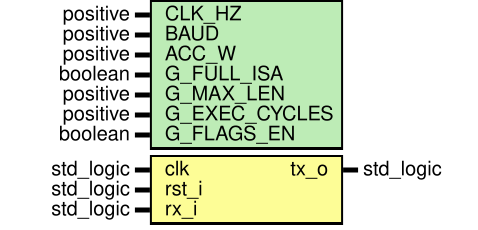

# Entity: cpu_top 
- **File**: cpu_top.vhd

## Diagram

## Generics

| Generic name  | Type     | Value      | Description |
| ------------- | -------- | ---------- | ----------- |
| CLK_HZ        | positive | 50_000_000 |             |
| BAUD          | positive | 115_200    |             |
| ACC_W         | positive | 16         |             |
| G_FULL_ISA    | boolean  | true       |             |
| G_MAX_LEN     | positive | 32         |             |
| G_EXEC_CYCLES | positive | 2          |             |
| G_FLAGS_EN    | boolean  | true       |             |

## Ports

| Port name | Direction | Type      | Description |
| --------- | --------- | --------- | ----------- |
| clk       | in        | std_logic |             |
| rst_i     | in        | std_logic |             |
| rx_i      | in        | std_logic |             |
| tx_o      | out       | std_logic |             |

## Signals

| Name            | Type                         | Description |
| --------------- | ---------------------------- | ----------- |
| rst_s           | std_logic                    |             |
| rx_s            | std_logic                    |             |
| tick_16x        | std_logic                    |             |
| tick_bit        | std_logic                    |             |
| rx_data         | byte_t                       |             |
| rx_valid        | std_logic                    |             |
| rx_error        | std_logic                    |             |
| parser_block    | std_logic                    |             |
| cmd_opcode      | opcode_t                     |             |
| cmd_rd          | regidx_t                     |             |
| cmd_ra          | regidx_t                     |             |
| cmd_rb          | regidx_t                     |             |
| cmd_imm         | byte_t                       |             |
| cmd_valid       | std_logic                    |             |
| cmd_error       | std_logic                    |             |
| dp_ra           | regidx_t                     |             |
| dp_rb           | regidx_t                     |             |
| dp_rd           | regidx_t                     |             |
| dp_imm          | byte_t                       |             |
| reg_we          | std_logic                    |             |
| result_ld       | std_logic                    |             |
| flags_we        | std_logic                    |             |
| alu_op          | aluop_t                      |             |
| sel_b           | std_logic                    |             |
| sel_res         | std_logic_vector(1 downto 0) |             |
| resp_valid      | std_logic                    |             |
| resp_err        | std_logic                    |             |
| resp_show_flags | std_logic                    |             |
| format_done     | std_logic                    |             |
| resp_data       | byte_t                       |             |
| resp_idx        | regidx_t                     |             |
| resp_flags      | std_logic_vector(3 downto 0) |             |
| tx_busy         | std_logic                    |             |
| tx_data         | byte_t                       |             |
| tx_valid        | std_logic                    |             |

## Instantiations

- u_input_sync: work.input_sync
- u_baud_gen: work.baud_gen
- u_uart_rx: work.uart_rx
- u_command_parser: work.command_parser
- u_cpu_control: work.cpu_control
- u_cpu_datapath: work.cpu_datapath
- u_response_formatter: work.response_formatter
- u_uart_tx: work.uart_tx
