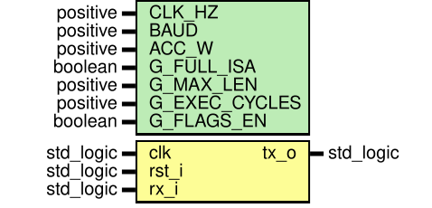

# `cpu_top`

[← Índice da documentação](../../readme.md) · **Autor:** Daniel Birenbaum (integração e ligação com a placa)

| | |
|---|---|
| **Fonte** | [`src/cpu_top.vhd`](../../../src/cpu_top.vhd) |
| **Testbench** | [`sim/tb_cpu_top.vhd`](../../../sim/tb_cpu_top.vhd) |
| **Teórico** | [`00_cpu_top_visao_geral.png`](../../theoretical/00_cpu_top_visao_geral.png) |

## Diagrama

## Interface física

| Porta | Dir. | Tipo | Descrição |
|---|---|---|---|
| `clk` | in | `std_logic` | Oscilador principal; frequência em `CLK_HZ` |
| `rst_i` | in | `std_logic` | Reset externo (botão), ativo em `1` |
| `rx_i` | in | `std_logic` | Recebe o TX do conversor USB-UART |
| `tx_o` | out | `std_logic` | Envia dados ao RX do conversor USB-UART |

UART a 115200 bit/s, 8N1, com GND comum ao conversor.

## Genéricos

| Genérico | Tipo | Padrão | Repassado a | Descrição |
|---|---|---|---|---|
| `CLK_HZ` | `positive` | `50_000_000` | `baud_gen` | Oscilador principal (50 MHz) |
| `BAUD` | `positive` | `115_200` | `baud_gen` | Taxa da UART |
| `ACC_W` | `positive` | `16` | `baud_gen` | Largura do acumulador NCO |
| `G_FULL_ISA` | `boolean` | `true` | `command_parser` | `false`: só `LDI` e `ADD` |
| `G_MAX_LEN` | `positive` | `32` | `command_parser` | Tamanho máximo da linha |
| `G_EXEC_CYCLES` | `positive` | `2` | `cpu_control` | Ciclos em `EXECUTA` |
| `G_FLAGS_EN` | `boolean` | `true` | `response_formatter` | Inclui `Z C N V` nas respostas da ULA |

## Instâncias

| # | Instância | Módulo | Função |
|---|---|---|---|
| 1 | `u_input_sync` | [`input_sync`](../uart/input_sync/readme.md) | Sincroniza reset e entrada serial |
| 2 | `u_baud_gen` | [`baud_gen`](../uart/baud_gen/readme.md) | Gera `tick_16x` e `tick_bit` |
| 3 | `u_uart_rx` | [`uart_rx`](../uart/uart_rx/readme.md) | Receptor UART |
| 4 | `u_command_parser` | [`command_parser`](../cpu/command_parser/readme.md) | Interpreta e valida a linha ASCII |
| 5 | `u_cpu_control` | [`cpu_control`](../cpu/cpu_control/readme.md) | FSM principal |
| 6 | `u_cpu_datapath` | [`cpu_datapath`](../cpu/cpu_datapath/readme.md) | Banco + ULA + MUXes + flags |
| 7 | `u_response_formatter` | [`response_formatter`](../cpu/response_formatter/readme.md) | Monta a resposta ASCII |
| 8 | `u_uart_tx` | [`uart_tx`](../uart/uart_tx/readme.md) | Transmissor UART |

## Sinais entre módulos

| Interface | Sinais |
|---|---|
| `input_sync` → todos | `rst_s`, `rx_s` |
| `baud_gen` → UART | `tick_16x` (RX), `tick_bit` (TX) |
| `uart_rx` → `command_parser` | `rx_data`, `rx_valid`, `rx_error` |
| `command_parser` ↔ `cpu_control` | `cmd_opcode`, `cmd_rd`, `cmd_ra`, `cmd_rb`, `cmd_imm`, `cmd_valid`, `cmd_error`, `parser_block` |
| `cpu_control` → `cpu_datapath` | `dp_ra`, `dp_rb`, `dp_rd`, `dp_imm`, `reg_we`, `result_ld`, `flags_we`, `alu_op`, `sel_b`, `sel_res` |
| `cpu_control` ↔ `response_formatter` | `resp_valid`, `resp_err`, `resp_show_flags`, `format_done` |
| `cpu_datapath` → `response_formatter` | `resp_data`, `resp_idx`, `resp_flags` |
| `response_formatter` ↔ `uart_tx` | `tx_data`, `tx_valid`, `tx_busy` |
