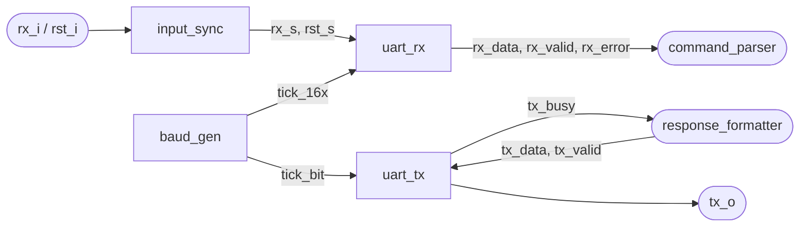

# Interface UART

[← Índice da documentação](../../readme.md) · **Autor:** Daniel Birenbaum

 **UART** (*Universal Asynchronous Receiver-Transmitter*) é um protocolo serial assíncrono usado para a troca
de dados entre o computador e o sistema digital (FPGA). Como não há linha de clock compartilhada, emissor e
receptor precisam combinar antes a taxa de transmissão (*baud rate*, em bits por segundo).

Neste projeto: **115200 bit/s, 8 bits de dados, sem paridade, 1 stop bit (8N1)**, com clock de 50 MHz.

## Blocos



| Módulo | Função | Página |
|---|---|---|
| [`input_sync`](../../../src/uart/input_sync.vhd) | Estabiliza as entradas assíncronas `rx_i` e `rst_i` | [doc](input_sync/readme.md) |
| [`baud_gen`](../../../src/uart/baud_gen.vhd) | Gera os *enables* `tick_16x` e `tick_bit` | [doc](baud_gen/readme.md) |
| [`uart_rx`](../../../src/uart/uart_rx.vhd) | Recebe quadros 8N1 por sobreamostragem 16× | [doc](uart_rx/readme.md) |
| [`uart_tx`](../../../src/uart/uart_tx.vhd) | Transmite quadros 8N1 | [doc](uart_tx/readme.md) |

## Quadro 8N1

```text
 linha em repouso = 1
 ──────┐┌───┬───┬───┬───┬───┬───┬───┬───┬─────┌──────
       │ S │D0 │D1 │D2 │D3 │D4 │D5 │D6 │D7 │ P │
       └───┴───┴───┴───┴───┴───┴───┴───┴───┘
       start  8 bits, LSB primeiro          stop
```


## `input_sync` — sincronização

Primeiro filtro dos sinais que chegam de fora da placa. `rx_i` e `rst_i` são assíncronos em relação ao clock
da FPGA, então cada um passa por **dois flip-flops encadeados** antes de ser usado em [`uart_rx`](uart_rx/readme.md).

- `rx_s` tem latência fixa de 2 bordas de clock e filtra pulsos mais curtos que um período.
- `rst_s` **entra assíncrono e sai síncrono**: a FPGA nasce em reset e libera após 2 bordas.

## `baud_gen` — geração de baud rate

O módulo não usa um divisor inteiro de clock. Ele usa um **acumulador de fase (NCO)** de `ACC_W` bits: a cada
ciclo soma `INC`, e o *carry* de saída é o tick.

```math
INC = \mathrm{round}\!\left(\frac{16 \cdot BAUD \cdot 2^{ACC\_W}}{CLK\_HZ}\right)
```

Para `CLK_HZ = 50 MHz`, `BAUD = 115200` e `ACC_W = 16`, `INC = 2416`. A frequência média de `tick_16x` fica em
1 843 261,7 Hz, o que dá um erro de **+0,0033 %** no baud, muito abaixo dos ~2 % que o receptor tolera.

- `tick_16x`: 16 ticks por bit; o `uart_rx` amostra o bit no meio (8º tick).
- `tick_bit`: coincide com um `tick_16x` a cada 16; a saída (TX) não precisa de sobreamostragem.

### Fontes e Referências


https://nandland.com/uart-serial-port-module/

https://www.youtube.com/watch?v=xLSgmDTRmCI

https://youtu.be/zAgO7IX_cTg?si=0tqmFfzmNgVkB5eB
