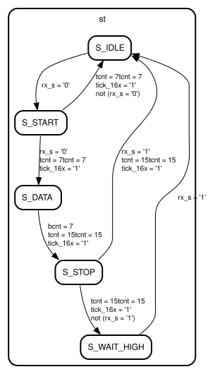

# Entity: uart_rx 
- **File**: uart_rx.vhd

## Diagram

## Ports

| Port name | Direction | Type                         | Description |
| --------- | --------- | ---------------------------- | ----------- |
| clk       | in        | std_logic                    |             |
| rst       | in        | std_logic                    |             |
| tick_16x  | in        | std_logic                    |             |
| rx_s      | in        | std_logic                    |             |
| rx_data   | out       | std_logic_vector(7 downto 0) |             |
| rx_valid  | out       | std_logic                    |             |
| rx_error  | out       | std_logic                    |             |

## Signals

| Name    | Type                         | Description |
| ------- | ---------------------------- | ----------- |
| st      | state_t                      |             |
| tcnt    | unsigned(3 downto 0)         |             |
| bcnt    | unsigned(2 downto 0)         |             |
| sh      | std_logic_vector(7 downto 0) |             |
| data_r  | std_logic_vector(7 downto 0) |             |
| valid_r | std_logic                    |             |
| err_r   | std_logic                    |             |

## Enums

### *state_t*
| Name        | Description |
| ----------- | ----------- |
| S_IDLE      |             |
| S_START     |             |
| S_DATA      |             |
| S_STOP      |             |
| S_WAIT_HIGH |             |

## Processes
- unnamed: ( clk )

## State machines

