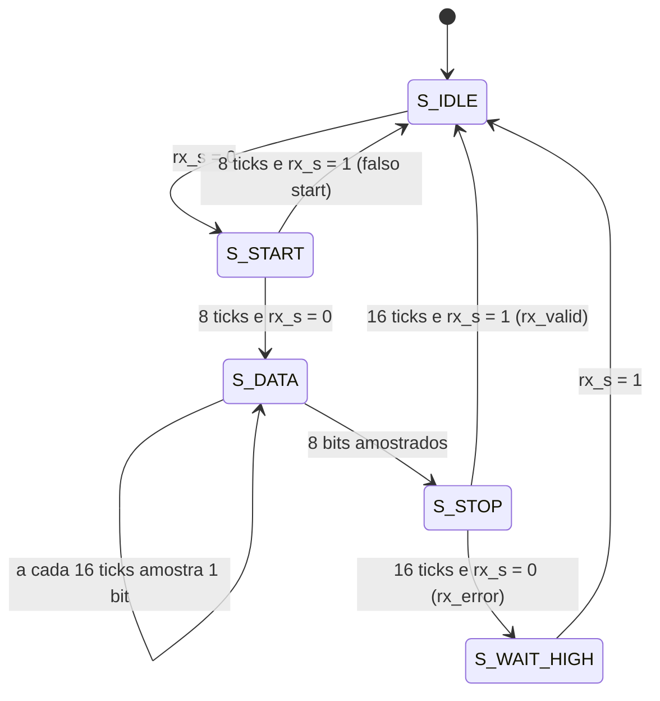

# `uart_rx`

[← Interface UART](../README.md) · [Índice](../../../readme.md) · **Autor:** Daniel Birenbaum

| | |
|---|---|
| **Fonte** | [`src/uart/uart_rx.vhd`](../../../../src/uart/uart_rx.vhd) |
| **Testbench** | [`sim/uart/uart_rx/tb_uart_rx.vhd`](../../../../sim/uart/uart_rx/tb_uart_rx.vhd) |
| **Teórico** | [`03_uart_rx.png`](../../../theoretical/03_uart_rx.png) |
| **Esquemático RTL** | [`schematic_uart_rx.svg`](schematic_uart_rx.svg) · **FSM:** [`fsm_uart_rx_00.svg`](fsm_uart_rx_00.svg) |

## Diagrama

## Portas

| Porta | Dir. | Tipo | Descrição |
|---|---|---|---|
| `clk` | in | `std_logic` | Clock principal |
| `rst` | in | `std_logic` | Reset síncrono (`rst_s`) |
| `tick_16x` | in | `std_logic` | *Enable* a 16 × baud, vindo do [`baud_gen`](../baud_gen/readme.md) |
| `rx_s` | in | `std_logic` | Linha serial já sincronizada pelo [`input_sync`](../input_sync/readme.md) |
| `rx_data` | out | `std_logic_vector(7 downto 0)` | Último byte recebido; estável entre quadros |
| `rx_valid` | out | `std_logic` | Pulso de 1 ciclo: `rx_data` válido |
| `rx_error` | out | `std_logic` | Pulso de 1 ciclo: *stop bit* inválido (erro de quadro) |

## Máquina de estados

| Estado | O que faz |
|---|---|
| `S_IDLE` | Linha em repouso; zera `tcnt` e espera a borda de descida do start bit |
| `S_START` | Conta 8 `tick_16x` (meio do start bit) e confirma `rx_s = 0`; senão, descarta como glitch |
| `S_DATA` | A cada 16 ticks (meio de cada bit) desloca `rx_s` para `sh`, LSB primeiro; ao fim de 8 bits vai para `S_STOP` |
| `S_STOP` | Espera 16 ticks e confere `rx_s = 1`: pulsa `rx_valid` e publica `rx_data`; senão pulsa `rx_error` |
| `S_WAIT_HIGH` | Após erro de quadro, espera a linha voltar a `1` antes de aceitar novo start |

Sinais internos

| Sinal | Tipo | Descrição |
|---|---|---|
| `st` | `state_t` | Estado atual |
| `tcnt` | `unsigned(3 downto 0)` | Contador de `tick_16x` dentro do bit |
| `bcnt` | `unsigned(2 downto 0)` | Contador de bits de dados |
| `sh` | `std_logic_vector(7 downto 0)` | Registrador de deslocamento |
| `data_r` | `std_logic_vector(7 downto 0)` | Byte publicado em `rx_data` |
| `valid_r` / `err_r` | `std_logic` | Pulsos de `rx_valid` e `rx_error` |

