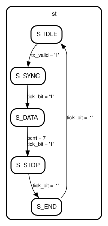

# Entity: uart_tx 
- **File**: uart_tx.vhd

## Diagram

## Ports

| Port name | Direction | Type                         | Description |
| --------- | --------- | ---------------------------- | ----------- |
| clk       | in        | std_logic                    |             |
| rst       | in        | std_logic                    |             |
| tick_bit  | in        | std_logic                    |             |
| tx_valid  | in        | std_logic                    |             |
| tx_data   | in        | std_logic_vector(7 downto 0) |             |
| tx_o      | out       | std_logic                    |             |
| tx_busy   | out       | std_logic                    |             |

## Signals

| Name | Type                         | Description |
| ---- | ---------------------------- | ----------- |
| st   | state_t                      |             |
| sh   | std_logic_vector(7 downto 0) |             |
| bcnt | unsigned(2 downto 0)         |             |
| tx_r | std_logic                    |             |

## Enums

### *state_t*
| Name   | Description |
| ------ | ----------- |
| S_IDLE |             |
| S_SYNC |             |
| S_DATA |             |
| S_STOP |             |
| S_END  |             |

## Processes
- unnamed: ( clk )

## State machines

