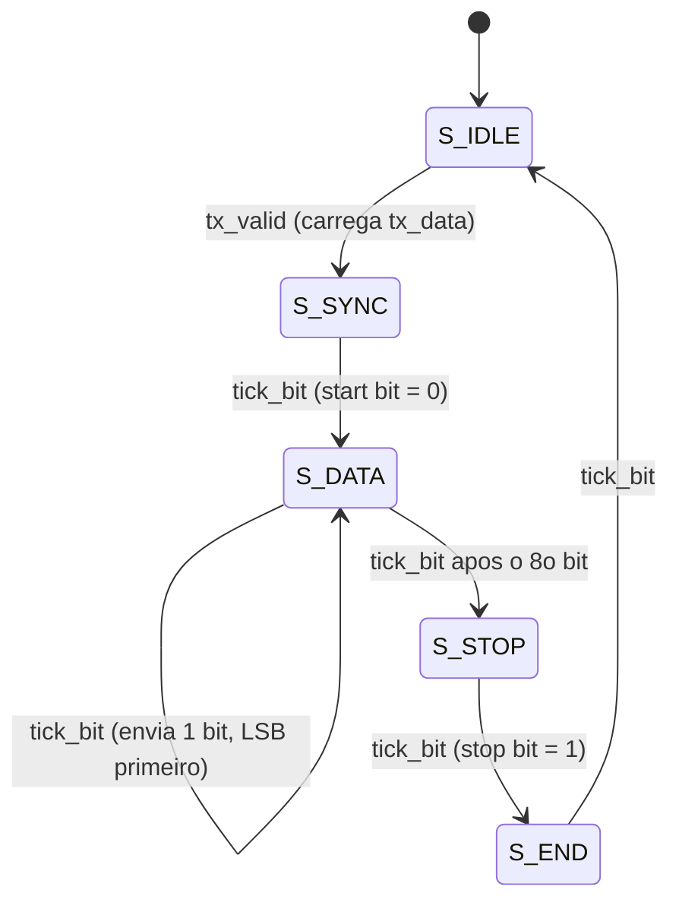

# `uart_tx`

[← Interface UART](../README.md) · [Índice](../../../readme.md) · **Autor:** Daniel Birenbaum

| | |
|---|---|
| **Fonte** | [`src/uart/uart_tx.vhd`](../../../../src/uart/uart_tx.vhd) |
| **Testbench** | [`sim/uart/uart_tx/tb_uart_tx.vhd`](../../../../sim/uart/uart_tx/tb_uart_tx.vhd) |
| **Teórico** | [`04_uart_tx.png`](../../../theoretical/04_uart_tx.png) |
| **Esquemático RTL** | [`schematic_uart_tx.svg`](schematic_uart_tx.svg) · **FSM:** [`fsm_uart_tx_00.svg`](fsm_uart_tx_00.svg) |

## Diagrama

## Portas

| Porta | Dir. | Tipo | Descrição |
|---|---|---|---|
| `clk` | in | `std_logic` | Clock principal |
| `rst` | in | `std_logic` | Reset síncrono (`rst_s`) |
| `tick_bit` | in | `std_logic` | *Enable* a 1 × baud, vindo do [`baud_gen`](../baud_gen/readme.md) |
| `tx_valid` | in | `std_logic` | Pedido de envio; só é aceito em `S_IDLE` (ignorado com `tx_busy = 1`) |
| `tx_data` | in | `std_logic_vector(7 downto 0)` | Byte a transmitir; lido no ciclo de `tx_valid` |
| `tx_o` | out | `std_logic` | Linha serial; em repouso fica em `1` |
| `tx_busy` | out | `std_logic` | `1` enquanto houver quadro em andamento (qualquer estado diferente de `S_IDLE`) |

## Máquina de estados

| Estado | O que faz |
|---|---|
| `S_IDLE` | Linha em `1`; ao ver `tx_valid`, carrega `tx_data` em `sh` |
| `S_SYNC` | Espera o próximo `tick_bit` para alinhar o início do quadro e então baixa a linha (start bit) |
| `S_DATA` | A cada `tick_bit` coloca `sh(0)` na linha e desloca; 8 bits, LSB primeiro |
| `S_STOP` | No próximo `tick_bit` leva a linha a `1` (stop bit) |
| `S_END` | Mantém o stop bit por um período de bit completo e libera `tx_busy` |

Sinais internos

| Sinal | Tipo | Descrição |
|---|---|---|
| `st` | `state_t` | Estado atual |
| `sh` | `std_logic_vector(7 downto 0)` | Registrador de deslocamento do byte |
| `bcnt` | `unsigned(2 downto 0)` | Contador de bits enviados |
| `tx_r` | `std_logic` | Registrador da linha `tx_o` |

